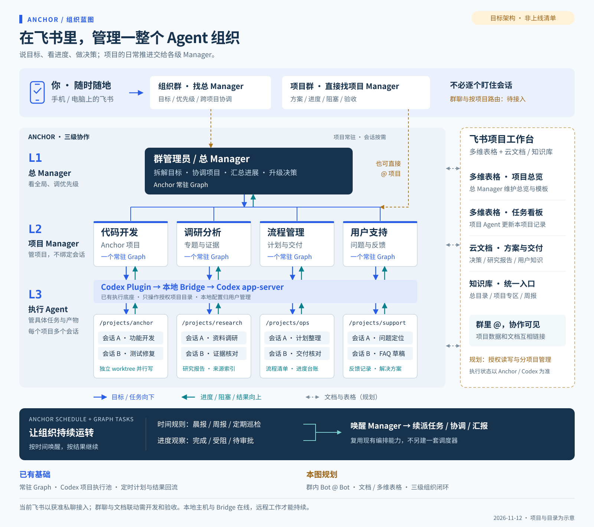

# 在飞书里，管理一个多层 Agent 组织

> **目标架构说明，不是已上线功能清单。** 飞书是人的协作入口，Anchor 负责组织与调度，项目 Manager 可以直接操作项目，也可以按需委派 Codex 等执行 Agent；云文档沉淀计划、过程和交付。

实现落点、必要通用能力与分片验收见 [AnchorWork 系统设计与实施计划](anchorwork-development-plan.md)；本文保留业务职责和体验约定，不把规划当部署状态。

人 @ 获准群内 Manager 的文本对话已验收；通用官方 CLI 工具及明确授权的原生 Bot 回复提及已实现，经理可按权限操作群、文档、Wiki 与 Base，无需逐接口开发。完整组织的资源结构和业务闭环不因工具接入自动建成。群与私聊历史隔离，不能把同一个 Manager Graph 理解为所有渠道共享一份会话。部署和真实验收结论见[统一台账](pilot-development-plan.md)。



## 三个层级，各管一件事

| 层级 | 谁负责 | 用户怎样协作 |
| --- | --- | --- |
| **L1 总 Manager** | 群管理员，对接多个项目 Manager；主动提炼需求、推动方案讨论与规划，协调目标、优先级和跨项目依赖，汇总风险与待决事项。 | 在组织群表达想法、讨论方案、作关键决定和看整体进展，不必事先写好完整需求或逐项催办。 |
| **L2 项目 Manager** | 每个项目由一个 Anchor 常驻 Graph 管理；直接读写、运行获准项目，拆任务、按需委派执行 Agent、跟进进度并组织验收。 | 在项目群直接讨论方案、追问进度、处理阻塞；不必事事经过总 Manager。 |
| **L3 执行 Agent** | 项目 Manager 按任务需要，通过 Codex Plugin 调度的执行资源；可用多个会话分别开发、测试、调研或整理资料，不是所有项目操作的必经层。 | 日常交给项目 Manager 协调；必要时由它定位具体会话，转交问题或调整任务。 |

**Manager 管项目，不等于某一个 Codex session。** 项目持续存在，会话按任务创建、续接与结束；并行修改同一仓库时使用独立 Git worktree。图中的四类项目只是例子，每个项目都可以拥有多个执行会话。

### 项目 Manager 自己能做事，Codex 按需调用

“Codex Bot”是接入能力的称呼，不是只能转发 Codex 指令的角色。项目 Manager 本身是有执行能力的 Anchor Agent：在自己的获准项目现场直接阅读源码和日志、修改文件、运行命令、构建和测试，再根据任务规模、并行收益与上下文需要决定是否调用 Codex。不能为了读一个文件、跑一次检查也强制新开 Codex 会话。

- **直接执行与委派共用项目归属。** 用户指定的本地项目目录是实际现场，不能把 Manager 的空白 `/workspace`、另一个 clone 或仅写在提示词里的宿主路径当成已经接入。Host 授权的 `project_read` / `project_edit` / `project_run` 复用现有 NodeTools 与沙箱，直接访问实际目录；普通 `anchor_*` 仍操作 Manager 笔记现场。具体读写权与运行环境由宿主授权，不经 Bridge 绕行，不开放整个宿主目录树。
- **Codex 是可选执行池。** Manager 可以自己完成任务，也可以委派长任务、独立工作流或并行实现，随后直接检查真实改动并验收。Codex 会话沿用同一获准项目或其独立 worktree，不维护另一份未说明的项目副本。直接执行同样要保持群对话可响应；长任务使用已有异步执行能力或委派，不在本轮连续等待至结束。
- **两条执行路径共享写入边界。** Manager 直接操作与 Bridge 受管写任务共用目录租约，同一工作树忙时不执行；并行写使用独立 worktree，或明确串行交接。该锁不约束未参与的本机终端。发现用户未提交改动先核对归属，不覆盖；新 worktree 不自动包含这些改动。Codex 内部委派或连接丢失时保守保锁，操作员核查后受控重启；不宣称未知子执行已经停止。
- **权限不随执行路径扩大。** 项目读写、命令运行、联网、凭据和部署仍分别遵守实际授权。Codex 被拒的操作不能改用 Manager 直接工具绕过；总 Manager 也不因组织层级更高就自动获得各项目目录。Bridge 不可用时，已独立授权的直接项目操作仍应可用，但不能据此声称 Codex 任务已恢复。

2026-11-13 已仅向 AnchorDevManager 绑定 `/home/mansteinl/Anchor`，排除 `.local`。真实飞书请求经工具发现完成读取 AGENTS.md、运行 Git 命令、创建/回读/删除一个临时文件，全程未开 Codex 会话；回复取得平台回执并回读确认。原群 Session、原生历史与笔记 Workspace 保留。总 Manager 未获得项目目录；持续项目推进、文档决策收集与自动调度不属于本切片。[常驻工程 Graph](project-maintainer-graph-design.md)的独立 clone 方案仍是另一交付。证据与保守持锁边界见[项目直连契约](codex-project-manager.md#manager-的本地项目直连)。

## 群聊、多维表格、文档库组成一个工作台

不是在云文档与多维表格之间二选一：**群里讨论与决策，云文档承载需求与方案，多维表格管理计划与推进，Anchor 执行并提供证据。** 飞书云文档体系是正式项目管理工作台，不是聊天后的可选归档；建立、持续更新和检查它是 Manager 的交付责任，不要求群主另行抄写。以下是拟采用的组织方式，不是已部署的配置。

| 载体 | 内容 | 谁维护 |
| --- | --- | --- |
| 组织群 / 项目群 | 派工、讨论、进度摘要、阻塞与待决事项；Manager 之间用真实的 Bot @ Bot 消息交接。 | 总 Manager 协调跨项目事项，项目 Manager 处理本项目事项。 |
| 多维表格 | 项目总览、任务与里程碑、问题与风险；关联负责人 Agent、群、文档和执行证据。 | 总 Manager 建立模板和全局总览；项目 Agent 更新本项目记录。 |
| 云文档 / 知识库 | 组织入口、项目专区、需求、方案、决策、调研报告、交付说明和支持知识。 | 总 Manager 维护目录与公共规范；项目 Agent 维护自己的项目专区。 |

多维表格先用三张关联表即可：**项目表、任务表、问题表**。记录与文档使用稳定项目 / 任务标识关联，不依赖名称匹配。群中给摘要和链接，不重复搬运整份文档。

### 文档化是推进的一部分，不是收尾补作业

每个项目使用统一的最小结构，可合并在少量文档及既有表格中，不要求每个任务新建一篇文档：

| 管理内容 | 正式记录 | 更新责任与时点 |
| --- | --- | --- |
| 项目入口 | 目标、范围、项目 Manager、当前里程碑、健康度及关联资料；汇总状态引用任务和问题记录 | 总 Manager 维护组织目录与项目总览，项目 Manager 在目标或阶段变化时更新本项目入口 |
| 需求与方案 | 问题背景、讨论结论、选项与取舍、验收标准、当前适用版本 | Manager 在澄清与方案讨论中持续整理；待确认内容明确标为草案，不伪装成用户决定 |
| 计划与执行 | 既有项目表、任务表中的里程碑、优先级、责任人、依赖、状态、下一步及执行引用 | 项目 Manager 在派工、结果返回、受阻与调整时更新；总 Manager 协调跨项目依赖 |
| 风险、待决与变更 | 既有问题表中的编号、问题、推荐、影响范围、决定来源与适用版本；详细依据链接至文档 | 总 Manager 汇总需群主处理的事项，项目 Manager 提供证据；决定落实后更新受影响计划 |
| 验收与交付 | 对照验收标准的结论、代码或产物引用、测试及部署证据、未覆盖边界和后续事项 | 项目 Manager 验收并收尾，总 Manager 检查业务交付及必要文档已齐备 |

**按关键变化维护，而不是生成流水账。** 需求明确后形成可引用的当前方案，获准执行前已有必要范围和验收标准；派工关联真实任务与方案版本；关键进展、阻塞、决定及范围调整更新同一记录；交付时将验收证据与后续事项补齐。已经明确授权的工作不为补排版重复请求批准，文档规范也不变成每一步都要群主审批的流程。

**群聊提供输入，Manager 负责落成可追溯记录。** 群主在群里的有效决定或文档指定区域的输入，由 Manager 核实身份、适用范围和版本后归入同一待决记录，并更新相关方案与计划；不要求群主再填写另一份表单。需求与方案保留草案、当前已确认及已被替代的区分；重要变更保留原决定的来源和替代关系，不静默覆盖。冲突只按明确影响范围等待确认，不以最后读取到的文字为准。

**业务记录与执行事实分别有权威来源。** 飞书维护需求、方案、优先级、业务计划与决定；任务执行、产物与投递结果仍引用 Anchor / Codex 的真实事实。项目首页和汇报是这些记录的摘要，不另建可独立改写的状态。需要随代码版本维护的技术契约仍以仓库文档为准，飞书记录业务说明及对应版本链接，不维护另一份冲突正文。

**文档交付也要验证。** 宣称已更新前回读目标记录或文档的相关内容，核对项目归属、版本及链接，并按可用权限信息检查群主的访问范围。没有群主身份的访问证据时，不把应用可读说成群主已能打开。文档或表格写入失败、冲突或结果未知时明确标记未完成，先核查现场，不盲目重建或覆盖；代码执行成功不等于文档交付成功。记录阻塞及后续处理，不因此重复执行已完成的编码工作，也不默认停止无关的已授权任务。

**规范由业务包承载。** 目录与字段模板、维护时点、职责和交付完整性检查归拟议的普通管理 Plugin 与 Manager Graph；读写复用现有飞书能力，实际权限与执行事实由原有宿主边界保证。不把项目文档类型写入 Kernel，也不另建项目数据库、审批平台或文档同步引擎。

### 谁能改什么

- 总 Manager 在已获授权的组织范围内建设文档库内容、创建项目入口和模板；它不是企业管理员，不自动拥有全部文档或其他 Bot 的权限。
- 项目 Agent 可更新自己的文档与任务记录；跨项目修改先交给对应负责人。边界由飞书资源授权和 Anchor 工具校验共同执行，不能只靠提示词或表格筛选视图。共享 Base 的行级授权需验证应用身份与租户权益；不足时按项目拆分 Base，由总 Manager 汇总，不向项目 Bot 开放全组织编辑权。
- 需求、优先级和截止日期属于业务输入；执行状态、错误和产物链接由 Anchor / Codex 的实际结果投影。人工修改执行状态不意味着后台任务已经完成；审批也不能靠随意填写表格或另一个 Bot 的一句同意代替。
- 文档按项目 / 章节分工更新，避免整篇覆盖；同一 Base 的 API 写入串行处理。检测冲突后重新读取，不覆盖用户刚作的修改。飞书接口本身也提示单一 Base 避免并发写入。[4][5]

### 群里的 @ 是协作入口，不是第二套任务引擎

总 Manager 可以在群里 @ 项目 Manager 派工，项目 Manager 可以 @ 其他项目请求配合，再 @ 总 Manager 汇报。使用已发布权限的应用机器人、真实 mention 结构和群内身份；只写普通字符串 `@名称` 不能代替消息中的提及对象。[1][2]

Anchor 按可信群、可信 Bot 和项目授权接纳输入。群消息与内部委派必须关联同一任务，不能各启动一份；去重以渠道消息身份为依据，收到自己或重复消息不继续派工。只在需要对方行动时 @，最终确认不反复互相唤醒，并限制自动往返。底层 Codex 会话仍由项目 Manager 管理，不必每条会话都注册一个飞书 Bot。

## 一个实际的协作场景

用户在组织群说：**“本周上线反馈功能，整理相关用户问题，每天下午向我汇报。”**

1. **总 Manager 分工：**开发项目做功能，支持项目整理反馈，调研项目补充方案依据，流程项目维护上线清单。
2. **项目 Manager 派工：**在各自项目目录下安排会话；开发与测试可以在独立 worktree 中并行推进。
3. **执行 Agent 交付：**输出代码、测试结果、报告或清单；项目 Manager 核对结果，更新本项目的任务记录与文档，并在群中 @ 总 Manager 附上证据链接。
4. **Anchor 持续跟进：**按授权保存巡检和汇报计划；通过进度观察、任务结果回流，让 Manager 决定续派、协调或升级。长任务不必等到全部结束才汇报。
5. **用户只处理关键事项：**在群里看摘要、点开文档、回答待决问题；也可以直接找某个项目 Manager 调整方向。

## 自动运转，不等于无人负责

**目标是事件接续，而不是周期催办：**任务结果、依赖变化和有效的人类决定应驱动 Manager 核查并推进下一步。现有 Graph Tasks 已提供结果回流；Codex 关键事件、跨 Manager 交接与文档决定的可信接入仍须补齐并验收，不把目标写成已部署能力。

**时间驱动只做补充：**用 Anchor Schedule 承载约定汇报、真实期限、长时间无进展检查和遗漏核对；没有变更推送的外部资源可有界轮询，不让整个组织依赖定时调用模型才能前进。

**人保留决策权：**授权范围内自动推进，超出权限、方向冲突和关键验收交回用户。总 Manager 不会因为层级更高就自动获得更多宿主权限。

### AnchorWork 的持续运营闭环（目标，尚未上线验收）

AnchorWork 不是等用户逐条催办的问答群，也不要求群主先交出完整需求。**群主负责关键取舍，AnchorManager 负责把想法变成可讨论的方案、可执行的计划和真实交付。** 总 Manager 主动发起有依据的讨论、提炼需求、协调项目经理，并把确实需要群主决定的事项集中交回；没有这类决定阻塞时，已授权工作应顺畅接续，不把“是否继续”交还给群主。

- **先帮助形成目标，再负责完成目标。** 根据已表达的想法、项目现场和反馈，Manager 先做获准的核查与调研，带着理解、备选和建议提问；只追问会改变目标、范围、验收或授权的缺口，不把内部实现选择变成用户问卷。讨论结果落为范围、验收标准、优先级、依赖和负责人；讨论不自动等于获准实施。
- **方案获准后持续推进。** 拆解、派工、协调、检查、修复和验收在既有授权内接续。每项未完成工作必须关联实际执行、已接纳的后续工作或明确的等待条件与恢复入口；聊天中的“稍后继续”不算安排，普通报告不能代替下一步。
- **需要群主决定时，等待是正常交接。** Manager 提交问题、方案、推荐、影响和等待范围，取得有效决定后核对当前计划再继续，无需群主另发“继续”。决定影响整体方向或群主要求时，整个组织可以停止新的业务派发；单项等待按明确影响范围处理，不一律拖停其他工作。暂停新派发不等于擅自取消已运行任务；未答复也不等于同意。
- **阶段完成不结束长期职责。** 验收、记录和收尾后推进已批准的后续承诺；没有下一项获准工作时，Manager 根据已有目标和证据主动准备下一阶段方案，与群主讨论，而不是只问“接下来做什么”。不凭阶段完成自动扩大范围，也不为了保持活跃编造任务。

```text
群主：目标 / 新想法 / 决策
  | 群内 @AnchorManager，或编辑约定的决策区域
  v
AnchorManager <--> 知识库 + 项目表 / 任务表 / 问题表
  | 拆解、排序、协调依赖                 ^
  v                                     |
项目 Manager --> 直接执行 / 委派 Codex --> 结果与证据
  ^                                     |
  +----------- 已授权的下一步 -----------+

任务结果 / 依赖变化 / 有效决定 --> AnchorManager
Schedule 期限与遗漏核对（补充） --> AnchorManager
  | 汇总待决事项、阻塞与期限，按约定提醒
  v
群主拍板 --> 更新同一条决策记录 --> 调整任务并继续推进
```

**每次唤醒都要作出推进判断。** 总 Manager 核对本次变化及受影响的任务，选择推进、协调、等待某项明确决策或结束已完成目标；不是只复述状态后问“是否继续”。单项待决只阻塞相关工作，组织级待决则按告知的范围停止新派发，不能一边宣称全体等待一边安排新工作。项目经理对本项目结果负责，总 Manager 引用其报告和证据；只有证据缺失、冲突或高风险验收才定向复核，不要求总 Manager 挂载所有仓库。可恢复的技术故障由体系在授权范围内核查处理，未知效果、权限不足和执行环境不可用仍须真实报告，不伪装成进展或普通产品决策。

**一个决策入口，两种输入方式。** 复用问题表中的“待决事项”类型，不另建审批平台。最小内容为稳定编号、关联项目/任务、要决定的问题、可选方案与经理建议、影响及最晚决策时间、待决/已决/已应用/取消、群主结论、来源与版本、后续任务引用。知识库放背景和方案，群里只放摘要、编号和链接。

- 群主可以回复“D-012 选 B，先做 Anchor”，也可以在知识库指定区域或关联记录填写结论；经理将两种输入归到同一编号，记录来源，再派发后续工作。当前群入口仍需真实 @Manager，或另行验证的定向回复；不假设机器人接收所有群消息。
- 新想法先记为提案并评估与当前目标的关系；明确行动指令在既有授权内进入任务，随口讨论不自动变成生产变更。信息不足时只询问真正影响下一步的一点。
- 文档决策必须能核实群主身份与适用版本；仅有编辑权限、机器人转述、“最后编辑人”或一段读到的文字，不足以证明具体结论来自群主。暂时无法归因时，在群里请求确认该条，而不是执行或忽略。群聊与文档结论冲突时只暂停受影响操作，不按读取先后猜测。
- 同一决策记录是业务结论的权威；群消息和文档提供来源，Manager 的工作区只保留引用和可重建视图。执行状态仍取 Anchor / Codex 的实际事实，人工把任务改成“完成”不替代验收。

**主动 Push 包括需求澄清、方案讨论和具体决策，不是空泛催促。** 提问或提醒必须说明“需要你补充或决定什么、当前理解和推荐是什么、影响什么、何时需要”。例如：“D-012：发布范围选 A 或 B；建议 B，能保住当前里程碑；请在约定期限前确认，否则仅暂停发布，测试继续。”期限取真实任务要求或群主约定，不临时编造。未答复不等于同意，已回答或已取消即停止提醒。

巡检频率与对人通知频率分开。聚合 Schedule 只补充期限、遗漏及无变更推送的文档核对；普通进展合并摘要，关键阻塞和临期决策按约定升级，只在需要行动时 @群主。试运行节奏作为可调整配置保存，包含提醒窗口、冷却间隔和暂停方式；尚未保存并核对真实计划前，不承诺周期运行。阶段收尾时主动准备并发起下一阶段的必要讨论；确实没有可推进工作或待讨论事项时安静等待，不自行创造任务、无限互相 @ 或循环消耗模型。群主暂停组织时停止新派发与催办；正在执行的工作是否中断须按明确指令处理。

**实现只补现有机制的缺口。** 复用 Schedule、Session 输入、Graph Tasks、Feishu CLI 与现有投递事实；不新建第二套 Agent loop、任务数据库或通用恢复引擎。普通回复与显式跨 Bot 交接要有清晰的发送责任，一份结果不能同时经 CLI 和自动最终答复重复投递。

当前需要补齐并验收的边界：

1. 总 Manager 的已授权定时唤醒与任务能力：2026-11-13 回读运行中的定义仅挂 `feishu` 与 `network`，尚无 `graph-tasks`。有 Schedule 基础设施不等于此 Manager 已可持续巡检。
2. 跨 Manager 的持续任务交接：当前群 peer 准入按同一人类根、每有向对一次限流，不能靠重发旧根或取消防循环限制实现长期派工。须在现有任务/Session 事实边界内设计有授权、可追踪的后续输入，不把定时器或文档变更伪装成人类来信；现有普通 Graph 委派也不等于能直接向常驻 Manager 派发。
3. 文档决策变更的发现、来源核验、去重和群通知：先对指定资源作有界巡检，事件订阅不是前置要求；复用已授权 CLI，但群结果输入及主动投递仍需真实业务验收，不沿用私聊授权代替。
4. Codex 关键事件回流与持续接续核查：Bridge 的原生事件可读不等于已自动进入 Manager 输入；须补齐可信接入，并核对未完成工作有真实执行或明确等待，不能靠报告措辞假定工作会继续。

第一条验收链只用 Anchor 项目：群主表达不完整想法 → Manager 主动澄清并讨论方案 → 形成获准计划 → 项目经理执行 → 遇到真实待决事项并主动提醒 → 按说明范围等待（包括组织级等待） → 群主在群或文档决策 → 无需再说“继续”便推进后续任务 → 回读完成证据 → 收尾并推进既有承诺或发起下一阶段讨论。还须验证决策不重复应用、无变更不刷屏、暂停后不再派发；关闭周期巡检后，已接入事件的核心执行与决定回流链仍可推进。本文定义目标与边界，不表示上述闭环已经部署。

文档管理同时验收：群主不翻聊天记录，仅从飞书项目入口就能找到当前需求和方案、计划与责任人、真实进展、待决事项及验收证据；群内决定已经归档并应用到正确版本，必要链接可访问。还须验证人工编辑冲突和写入失败会被如实呈现，而非以群里一句“已完成”替代规范交付。

## 从一条真实闭环开始

先用一个组织群、一个总 Manager、两个项目 Manager、一个获准知识空间和一套项目表验收：**用户交代目标 → 总 Manager 建立项目入口与任务 → 群中 @ 项目 Manager → 执行并更新本项目文档 / 表格 → 回群汇报 → 总 Manager 汇总。** 之后再扩展多项目、定时周报和自动跟进，不先另建协作平台。

首次初始化有一个平台限制：**创建新的 Wiki 知识空间只支持用户身份，不支持应用身份**；可以由用户先建好并授权，或经用户 OAuth 授权后代建。之后，应用可以在已获父节点编辑权限的空间中创建项目文档等节点。开通 API 权限与取得具体资源权限是两件事，二者都要满足。[3][6][7]

## 现有基础与规划边界

| 已有基础 | 本图规划，需要接入与验收 |
| --- | --- |
| 常驻助手 Graph、本地 Codex 多会话执行池、授权项目目录和并行 worktree、定时计划与任务结果回流；人 @ 获准飞书群的文本渠道已部署。 | 通用 CLI 与原生 peer 协作已实现；真实租户、云文档 / 知识库 / 多维表格资源配置、项目级权限与多层 Manager 的跨项目业务闭环仍逐项验收。 |

当前组织总管和 Anchor 项目经理已在用户指定的 **AnchorWork** 群通过真实人 @ 收发验收：用户确认两者回复，后台均有原群投递 confirmed，见验收证据（本机原件，未入库：`.local/anchorwork-activation-20261112/group-acceptance.json`）。仅授权既有私聊用户，其他群不自动开放；SeeMine 与 Codex Manager 的独立项目 Bot 尚未上线。这不代表图中的 Bot 协作与文档管理已经接通。Codex 的登录、模型服务和本地配置由用户管理；Anchor 通过 Plugin / Bridge 使用获准能力。远程操作需要 Anchor 宿主在线；Codex 委派另需 Bridge 在线，目标中的 Manager 直接执行路径不依赖 Bridge。调研、文档和用户支持也必须分别接入所需的授权工具，不会因有 Codex 会话就自动获得外部系统权限。

**最终体验：人不必守着终端或逐个催任务，在飞书里说目标、看进展、做决策，日常推进由有分工的 Agent 组织承担。**

当前实现依据：[Codex 项目经理](codex-project-manager.md)、[飞书渠道](feishu-assistant.md)、[Graph 任务与结果输入](architecture.md#按需-graph-任务与结果输入)。本文是组织蓝图，不替代这些实现契约；示例目录和项目均为示意。

平台接口依据（2026-11-12 核对；未替代真实租户验收）：[接收消息][1]、[Bot @ Bot 协作][2]、[创建知识空间][3]、[多维表格概述][4]、[更新记录][5]、[创建知识节点][6]、[文档授权][7]。

[1]: https://open.feishu.cn/document/server-docs/im-v1/message/events/receive.md
[2]: https://open.feishu.cn/document/mcp_open_tools/integrating-agents-with-feishu/agent-at-agent-for-complex-tasks.md
[3]: https://open.feishu.cn/document/server-docs/docs/wiki-v2/space/create.md
[4]: https://open.feishu.cn/document/server-docs/docs/bitable-v1/bitable-overview.md
[5]: https://open.feishu.cn/document/server-docs/docs/bitable-v1/app-table-record/update.md
[6]: https://open.feishu.cn/document/server-docs/docs/wiki-v2/space-node/create.md
[7]: https://open.feishu.cn/document/server-docs/docs/permission/permission-member/create.md
